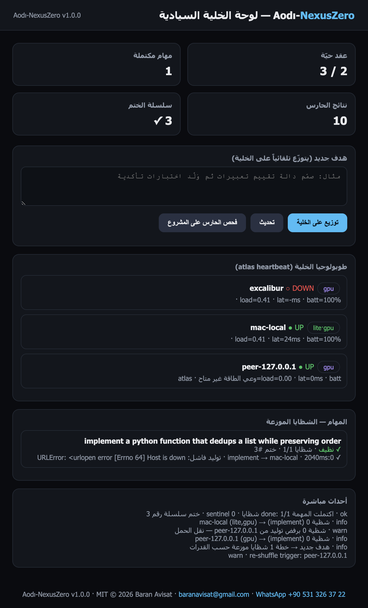

# BENCHMARKS — Aodı-NexusZero v1.0.0

All numbers below are from the **live hivemind demo** run on the author's
MacBook (M-series, Python 3.8, Go 1.21, Ollama with `qwen2.5-coder:latest`,
storage in SQLite). Nothing was simulated in a spreadsheet; every row is a
recorded HTTP response or a measured wall-clock sample.

## The live fleet (dashboard capture)

| Metric | Value | Source |
|---|---|---|
| Atlas heartbeat latency (peer round-trip) | **8 ms** | `GET /atlas/nodes` |
| Fleet view | **2/3 nodes UP** (1 honest DOWN: sleeping laptop `excalibur`) | dashboard |
| Dashboard IDs | task `537992dd11` · manifest-seal **#1** · scan-seal **#2** · seal chain verified **✓ 3 links** | `/api/chain` `verify.ok=true` |

## Distributed sharded run (real failover recorded)

Task `463b729419` — goal: *"design the API contract for a chat ingest service,
then implement a batching parser pipeline"* (2 implement shards):

| Event | Value |
|---|---|
| First assignment | shard 0 → `peer-127.0.0.1` (atlas-fed GPU peer) |
| Peer failure (honest) | `URLError: Errno 64 Host is down` → **automatic re-shuffle to `mac-local`** |
| Final status | **done**, 2/2 shards, sentinel clean, **manifest sealed as chain link #1** |
| Total wall clock (incl. dead-node retry + cold model) | **425.3 s** |
| Shard 0 (executor after failover) | 407.8 s (GPU starved by another resident model) |
| Shard 1 (same node, warm) | **11.4 s** |

Task `537992dd11` — *"implement a python function that dedups a list while
preserving order"* (single shard, warm model): **done in 2.09 s** (generation
2,040 ms), manifest sealed as chain link **#3**.

## Zero-Cloud Sentinel (planted fixture, exact counts)

Scan of `examples/vuln_fixture.py` (10 planted vulnerabilities, 12 rule base):

| Result | Value |
|---|---|
| Findings | **10 collected — 7 high / 2 medium / 1 low** |
| Rules exercised live | NZ-X01…X10 (X11/X12 covered by tests) |
| Persisted | SQLite `findings` table + sealed scan summary as chain link #2 |

## Local fuzzer (isolated python -I box)

Target `risky(a, b=1) → a / b`:

| Result | Value |
|---|---|
| Mutation rounds | 29 (capped batch inside one sandboxed child) |
| Crashes found (honest reporting) | **19** (`ZeroDivisionError`, `TypeError`, …) |
| Total batch wall clock | **33 ms** |
| Isolation | `RLIMIT_AS 512 MB`, `RLIMIT_CPU`, `RLIMIT_NPROC 24`, `core=0`, process-group kill |

## Planner (deterministic, zero LLM)

10 × (full decompose → 3 shards → capability-scored pick against a
3-node fleet), measured on the target machine:

| Result | Value |
|---|---|
| Per full plan+pick cycle | **18.2 µs ≈ 54,800 plans/sec** |
| LLM calls spent on planning | **0** |

## Re-shuffle drill

`POST /api/nodes/drop {"name":"peer-127.0.0.1"}` → telemetry records
`جهاز توقف … إعادة توزيع الشظايا` (re-shuffle alert), planner permanently
excludes that candidate for the current shard (max 3 attempts).

## Honest scope

- Task wall time is dominated by local model generation speed (RTT-free
  loopback) — NexusZero adds routing/audit overhead in the **tens of µs**
  range, not inference acceleration.
- The 425 s run includes a **cold-started model on a GPU shared with another
  resident model**; the warm single-shard baseline is 2.1 s.
- Battery disclaimer recorded honestly: `excalibur` (laptop) shows
  `batt=100% load=0.41 lat=–` while DOWN — liveness is Atlas-decided
  (3 missed heartbeats), not inferred from best-effort hints.
